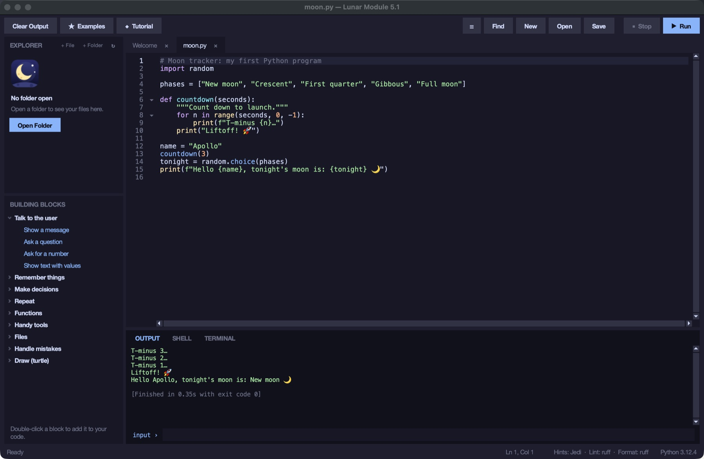

<p align="center">
  
</p>

<h1 align="center">Lunar Module</h1>
<p align="center"><b>A friendly Python editor for beginners.</b><br>
Write your first program, press ▶ Run, and watch it work.<br>
Free for macOS, Windows and Linux.</p>

<p align="center"></p>

## Download

| Your computer | Download |
|---|---|
| **Mac** with an Apple chip (M1 or newer) | [**LunarModule-mac.zip**](https://github.com/SleepyDev1010/LunarModule-download/releases/latest/download/LunarModule-mac.zip) |
| **Windows** 10 or 11, 64-bit | [**LunarModule-windows.zip**](https://github.com/SleepyDev1010/LunarModule-download/releases/latest/download/LunarModule-windows.zip) |
| **Linux** 64-bit (Ubuntu 22.04+, Mint, Debian 12+, Fedora…) and Chromebooks | [**LunarModule-linux.tar.gz**](https://github.com/SleepyDev1010/LunarModule-download/releases/latest/download/LunarModule-linux.tar.gz) |

Older versions and release notes: [Releases](https://github.com/SleepyDev1010/LunarModule-download/releases)

## Step 1: Install Python (recommended)

Lunar Module uses the Python on your computer to install packages (like pygame) and to turn programs into apps. Get it from **[python.org/downloads](https://www.python.org/downloads/)**. On Windows, tick **“Add python.exe to PATH”** in the installer.

Lunar Module finds Python by itself, even if you install it while the app is open. Until then, a built-in Python still runs your programs.

## Step 2: Open Lunar Module

<details open>
<summary><b>Mac</b></summary>

1. Unzip `LunarModule-mac.zip` and drag **Lunar Module** into your **Applications** folder.
2. Open it. The first time, macOS says it can't check the app: click **Done**.
3. Open **System Settings › Privacy & Security**, scroll down and click **Open Anyway** next to Lunar Module.

You only do this once. It happens because Lunar Module isn't notarized by Apple yet.
</details>

<details>
<summary><b>Windows</b></summary>

1. Right-click `LunarModule-windows.zip` and choose **Extract All**.
2. Open the folder and double-click **Lunar Module.exe**.
3. If you see “Windows protected your PC”, click **More info**, then **Run anyway**.

Tip: right-click **Lunar Module.exe › Send to › Desktop (create shortcut)**.
</details>

<details>
<summary><b>Linux</b></summary>

```sh
tar xzf LunarModule-linux.tar.gz
cd LunarModule
./install.sh          # adds Lunar Module to your app menu (no sudo needed)
```

Or run it without installing: `./"Lunar Module/Lunar Module"`. The full guide is in `README.txt` inside the download, and `./uninstall.sh` removes it again.
</details>

## What's inside

- **Lessons** that check your work, and ready-to-run **examples**
- **Errors explained in plain English**
- **Building Blocks**: double-click to add code
- A **package manager** that checks packages before installing them
- A real **terminal**, a **debugger**, and **Make an App**
- An optional, **free AI helper** that runs on your own computer with [Ollama](https://ollama.com): no account, no cost, nothing sent online
- **Seven themes**, your choice of code font, tab size and more

## License

Lunar Module is **free to download and use**. Copyright © 2026 SleepyDev, all rights reserved: please don't copy, redistribute or modify it. Share the link to this page instead. Programs you write with it are yours. See [LICENSE.txt](LICENSE.txt).

This repository only holds the downloads. The source code is private.
